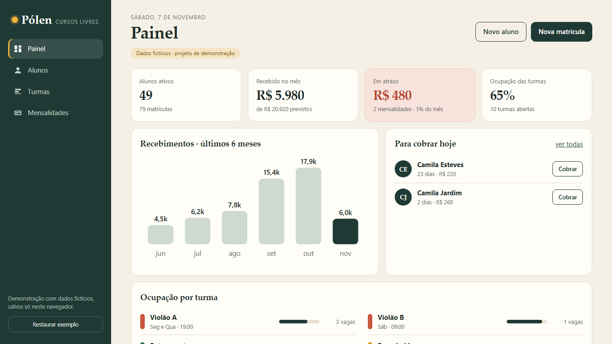
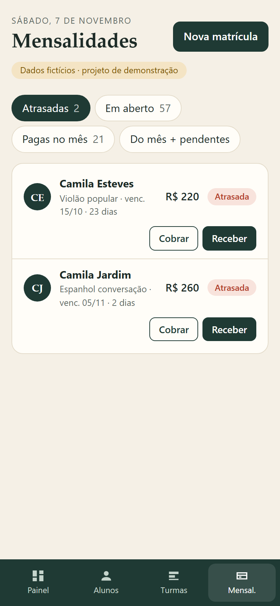

# Pólen — school CRM demo

A small CRM for a fictional language/arts school ("cursos livres"): students, classes and monthly tuition, in one clean dashboard. Built with **Lit** (web components) + TypeScript + Vite.

**Live demo:** https://alissonlittig.github.io/polen-escola/

> All data is fictional and generated locally. Everything is stored in your browser's `localStorage`; nothing is sent anywhere. "Cobrar" only copies a message to the clipboard.

| Dashboard | Mobile |
|---|---|
|  |  |

## What it does
- **Dashboard:** active students, received vs. expected revenue, overdue amount, class occupancy, 6-month revenue chart, "who to charge today".
- **Students:** search, profile with enrollments and tuition history, quick enroll/cancel.
- **Classes:** schedule, teacher, room, seats left, roster; full classes are blocked from new enrollments.
- **Tuition:** overdue / open / paid filters, receive via Pix, card or cash, copy a reminder message.
- Monthly invoices are generated automatically when a new month starts.

## Run
```bash
npm ci
npm test      # vitest: tuition status, enrollment rules, month rollover
npm run build
npm run dev
```

The business rules live in `src/logic.ts` (pure functions, unit-tested); the UI is a single light-DOM Lit element in `src/app.ts`. CI (GitHub Actions) runs tests, builds and deploys to GitHub Pages on every push to `main`.

Lighthouse (mobile): performance 94, accessibility 100, best practices 100, SEO 91.
